# P.A.I.M.O.N

**Trợ lý thị giác máy tính cho Genshin Impact — từ dữ liệu tự thu thập đến bản đồ và hỗ trợ khiêu chiến Boss.**

P.A.I.M.O.N kết nối ba bài toán: tạo dữ liệu gameplay có nhãn, định vị để hỗ trợ khám phá, và nhận biết hành động/cơ chế Boss từ chuỗi hình ảnh. Đầu ra hướng tới người chơi: bản đồ, hướng mục tiêu, box đối tượng, trạng thái và cảnh báo overlay.

**Kho công khai này giới thiệu sản phẩm, demo, mẫu dữ liệu và checkpoint. Mã nguồn ứng dụng được giữ riêng.** Bản EXE chưa được phát hành trong đợt giới thiệu này.

[Demo Boss](#demo-boss-vision) · [Dataset](docs/dataset-card.md) · [Map](docs/map.md) · [Checkpoint](docs/model-card.md) · [Tải tài nguyên](https://github.com/nbngoc123/P.A.I.M.O.N/releases/tag/lizard-showcase-v0.1)

## Ba phần giải quyết điều gì?

| Phân hệ | Bài toán | Người dùng nhận được |
|---|---|---|
| **[Genshin Data](docs/data-collector.md)** | Biến bản ghi gameplay thành dữ liệu có thời gian, vùng ảnh và nhãn có thể kiểm tra | Công cụ thu OBS, xử lý video, duyệt box và đoạn hành động trong cùng luồng, xuất/cập nhật dataset |
| **[Spatial Map / GVL](docs/map.md)** | Xác định vị trí từ minimap, nối vị trí với bản đồ và các điểm cần tìm | Bản đồ overlay, mục tiêu và hướng tương đối, tầng, bộ lọc ghim, chế độ thu thập đặc sản |
| **[Boss Vision](docs/boss-vision.md)** | Biết Boss/vật thể ở đâu và nhận biết trạng thái thay đổi theo thời gian | Box và tracking ID, điểm từng nhãn, crop tín hiệu và cảnh báo theo profile Boss |

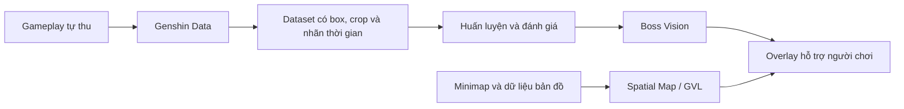

Hai bài toán Map và Boss Vision có luồng xử lý riêng. Sơ đồ mô tả hệ sinh thái; không khẳng định đã có một EXE hợp nhất cả ba ứng dụng.

## Demo Boss Vision

**Hai Boss minh họa: Thằn Lằn Ánh Trăng Bức Xạ và Dottore.**

### Thằn Lằn Ánh Trăng Bức Xạ

Ảnh suy luận xem trực tiếp trên GitHub, trích từ nhiều thời điểm trong cùng phiên. Bấm vào ảnh để xem bản lớn.

**0.8s — Mở đầu: box Boss, vật thể và cảnh báo vào cơ chế.**

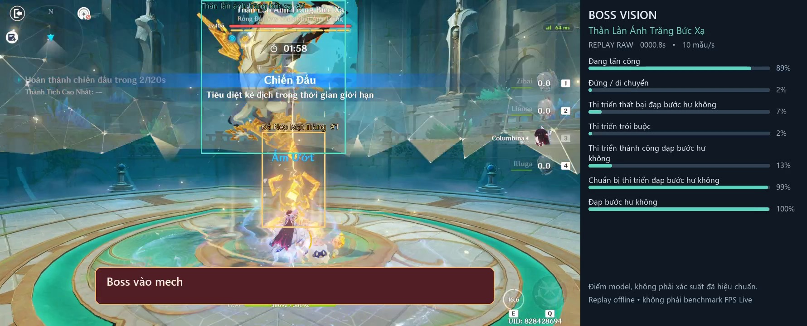

**1.5s — Cảnh báo phá hủy khiên và điểm mechanic.**

**14.7s — Cảnh báo chuẩn bị hồi máu.**

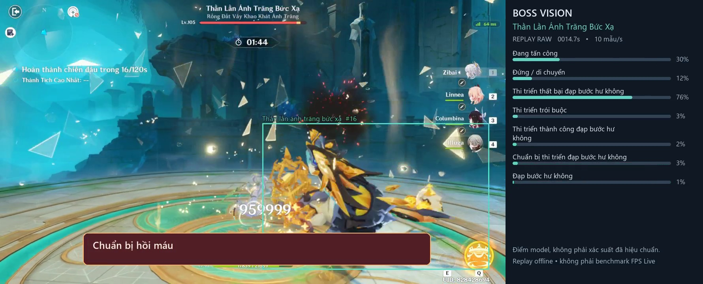

**32.0s — Box và trạng thái ở góc nhìn khác.**

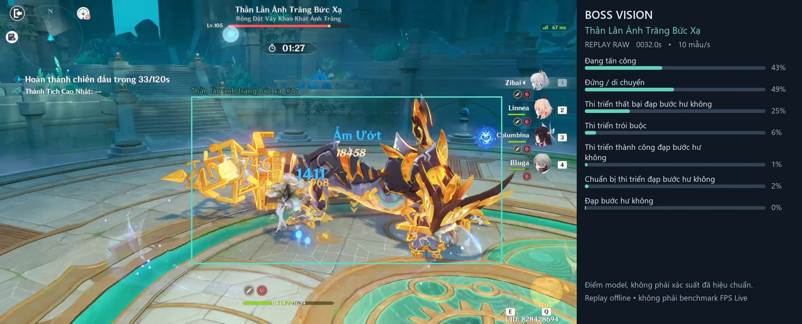

**68.3s — Box, điểm trạng thái và cảnh báo cuối chu kỳ.**

**71.7s — Cơ chế lặp lại: cảnh báo phá hủy khiên.**

**[Xem toàn bộ 12 ảnh suy luận](docs/boss-gallery.md)** · [Nguồn và cấu hình demo](media/boss/demo-provenance.json)

Tải video đầy đủ (120,2 giây)

[Download MP4](https://raw.githubusercontent.com/nbngoc123/P.A.I.M.O.N/main/media/boss/lizard-raw-inference.mp4). Video khoảng 52 MB; có thể tải về để xem khi trang file GitHub không hiển thị bản xem trước.

Bộ ảnh được trích từ video dựng bằng suy luận lại video raw của phiên `20261111-235058-e2e170d8`, với checkpoint đã được gán trong profile. Box, điểm state/mechanic và cảnh báo được tạo từ đầu ra mô hình cùng chính sách cảnh báo; không lấy nhãn thời gian để giả làm dự đoán.

- Box: Boss và vật thể cơ chế theo các lớp detector đã học.
- Tracking: liên kết đối tượng giữa các frame, giữ ngữ cảnh chuyển động.
- Temporal: kết hợp chuỗi ảnh, đặc trưng đối tượng và các vùng crop đã cấu hình.
- Cảnh báo: ngưỡng bật/tắt, thời gian xác nhận và cooldown theo từng nhãn.
- Overlay trong ảnh là lớp vẽ khi replay offline; đây chưa phải ảnh chụp desktop overlay khi chơi trực tiếp.

**Giới hạn:** nguồn demo có thể trùng dữ liệu huấn luyện. Video cho thấy luồng suy luận hoạt động; không chứng minh độ chính xác trên phiên độc lập hoặc FPS Live. Điểm hiển thị là điểm model, không phải xác suất đã hiệu chuẩn. [Chi tiết Boss Vision](docs/boss-vision.md).

### Dottore — box, cơ chế và cảnh báo

Suy luận raw từ phiên `20261108-233718-7e7c7523` bằng checkpoint đã gán trong profile Dottore. Các cảnh dưới đây lấy trực tiếp từ video đầu ra; cảnh báo phát từ điểm model và chính sách trong profile.

**4.8s — Cảnh báo do model kích hoạt: Nấp sau di hài cổ vật! Boss sắp tung đòn đặc biệt..**

**14.2s — Cảnh báo do model kích hoạt: Boss sắp hút năng lượng nguyên tố hoặc di chuyển ngược!.**

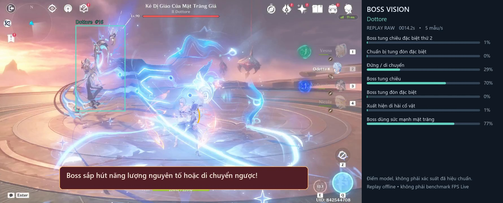

**3.0s — Box, tracking và điểm state/mechanic trong replay.**

**7.0s — Box Dottore, Di Hài Cổ Nguyệt và vật thể mặt trăng; có cảnh báo từ model.**

**92.0s — Box Dottore trong cảnh chiến đấu; điểm trạng thái Boss tung chiêu.**

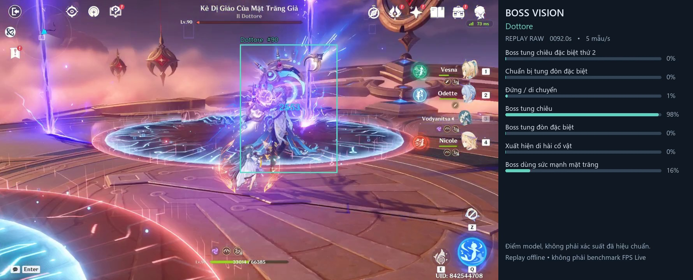

**[Xem toàn bộ ảnh Dottore và tải video](docs/dottore-gallery.md)**. Replay offline; thông báo có thể sai hoặc muộn, chưa phải benchmark độc lập.

## Bộ dữ liệu tự xây dựng

Bộ thu và công cụ gán nhãn được xây dựng để phục vụ chính các bài toán trong P.A.I.M.O.N, thay vì chỉ lưu ảnh rời rạc.

- Video gốc theo phiên, timestamp/PTS và nguồn ảnh rõ ràng.
- Box Boss và các vật thể liên quan đến cơ chế.
- Các đoạn state/action/mechanic; nhiều nhãn có thể đồng thời tồn tại.
- Crop vùng tín hiệu, ROI và phiên bản cấu hình vùng.
- Phân biệt nhãn đã duyệt, chưa duyệt và khoảng loại khỏi đánh giá.

Repo kèm **một mẫu nhỏ** từ phiên Thằn Lằn, gồm ảnh thật, nhãn YOLO, crop và nhãn thời gian liên quan. Mẫu không đại diện toàn bộ dữ liệu và không phải benchmark độc lập.

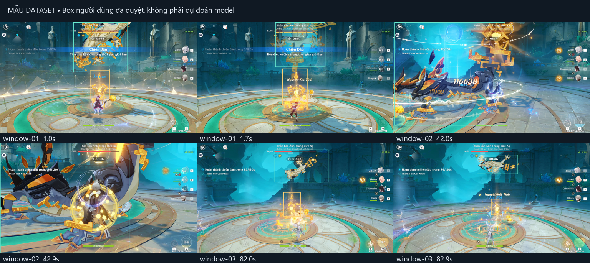

Màu xanh là box Boss; màu vàng là vật thể nếu frame có nhãn tương ứng. Đây là ảnh minh họa ground truth đã duyệt, không phải đầu ra suy luận.

**[Xem dataset card](docs/dataset-card.md)** · [Mở mẫu dữ liệu](samples/lizard/README.md)

## Bản đồ và hỗ trợ khám phá

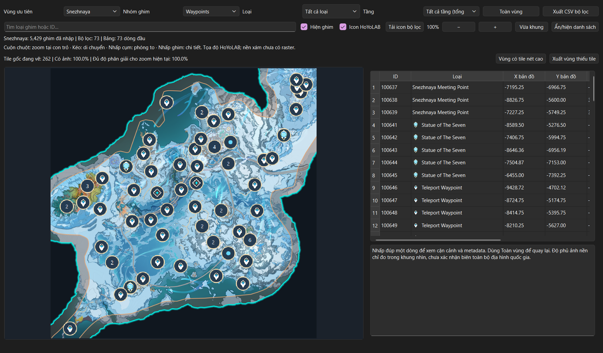

Map giải quyết việc nối **ảnh minimap đang thấy → vị trí trên bản đồ → điểm cần tìm**, sau đó thể hiện hướng mục tiêu và tiến độ khám phá bằng HUD.

- Định vị qua so khớp đặc trưng và theo dõi giữa các lần khớp.
- Hiển thị map, ghim, icon, tầng và các bộ lọc.
- HUD bản đồ, điều hướng theo mục tiêu và cấu hình giao diện/phím tắt.
- Chế độ thu thập đặc sản riêng: đánh dấu các điểm trong bán kính và chuyển mục tiêu tiếp theo.

Đánh dấu theo bán kính là **ước lượng đã ghé điểm**, chưa phải nhận biết người chơi nhặt thành công. Hướng XY không phải tuyến đi tối ưu tránh vật cản. Đã có demo replay từ gameplay raw ở bên dưới; ảnh trên là giao diện catalog. [Chi tiết Map và giới hạn](docs/map.md).

### Demo Map từ video raw

Hai bản ghi gameplay được chạy lại qua bộ định vị và Map/HUD hiện có. Các thao tác chọn mục tiêu, bật thu thập và hoàn tác được thực hiện khi replay; không cần OBS ghi được overlay desktop.

**Định vị và bám vị trí**

**Điều hướng tới ghim**

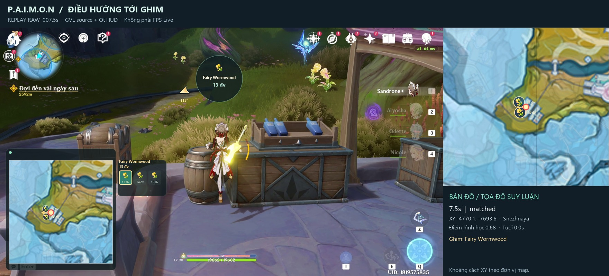

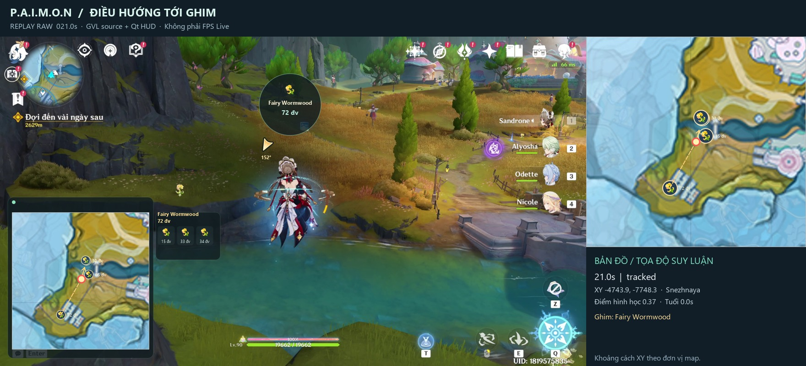

**Thu thập đặc sản và hoàn tác**

**[Xem toàn bộ ảnh và tải ba video Map](docs/map-gallery.md)**. Replay offline; khoảng cách XY theo đơn vị map. Thu thập đánh dấu theo bán kính, chưa nhận biết nhặt vật phẩm.

### Các góc nhìn giao diện Map

**Tầng ngầm trong hệ tọa độ chung.** Ảnh giao diện ghép tầng; trạng thái chờ minimap không phải bằng chứng định vị thành công trong hang.

**Cấu hình HUD điều hướng và mục tiêu.**

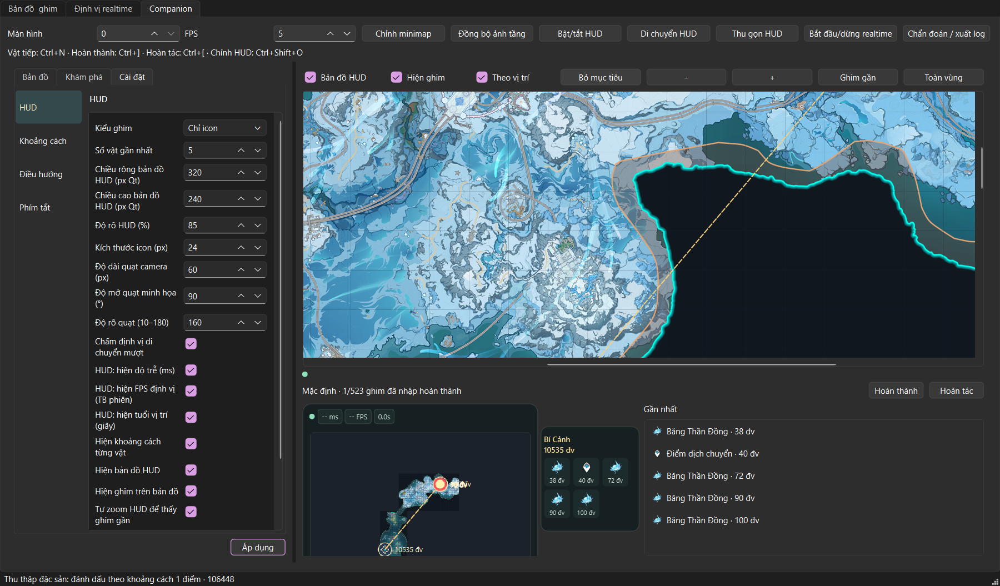

**Chế độ thu thập đặc sản.** Chọn loại, bán kính và thời gian chờ; đánh dấu theo khoảng cách chưa xác nhận đã nhặt vật phẩm.

**Kiểm tra bố cục mũi tên ở nhiều góc.** Đây là ảnh kiểm tra tổng hợp, không phải kết quả định vị gameplay.

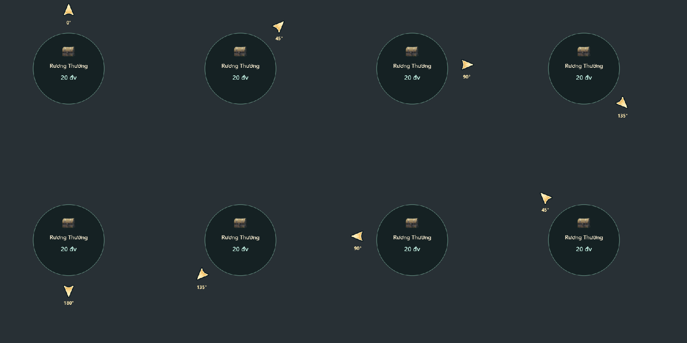

## Checkpoint, phần mềm và trạng thái

| Tài nguyên | Phát hành |
|---|---|
| Demo Thằn Lằn và Dottore | Video và ảnh trong repo |
| Mẫu dataset | Trong `samples/lizard`, ảnh và nhãn chọn lọc |
| Checkpoint detector + temporal | File ZIP ở [Releases](https://github.com/nbngoc123/P.A.I.M.O.N/releases/tag/lizard-showcase-v0.1), kèm hash và profile tương ứng |
| Ứng dụng Windows EXE | Chưa phát hành công khai |
| Mã nguồn ba ứng dụng | Giữ riêng |
| Voice assistant, tối ưu lộ trình và mở rộng nhiều Boss | Hướng phát triển; không thuộc cam kết của demo này |

Việc công khai checkpoint không có nghĩa công khai mã nguồn ứng dụng. Temporal cần đúng feature schema, thứ tự lớp, crop và cách dựng chuỗi; không thể dùng checkpoint đó như một detector YOLO độc lập. [Model card](docs/model-card.md).

## Đánh giá và giới hạn

Boss Vision được theo dõi bằng chất lượng box và chất lượng cảnh báo theo từng lần sự kiện: nhận được, bỏ sót, độ trễ, báo sai/phút và báo lặp. Map cần đánh giá độ ổn định định vị, thời gian tìm lại và độ trễ khi di chuyển. Không dùng một con số mAP để đại diện cho toàn bộ hệ thống.

Đây là dự án cá nhân thử nghiệm, không phải sản phẩm chính thức của HoYoverse. Hình ảnh và nội dung game thuộc chủ sở hữu tương ứng. Kho công khai không tự cấp quyền sử dụng lại nội dung game hoặc giấy phép cho toàn bộ phần mềm/dataset; xem [phạm vi phát hành](docs/distribution.md).
