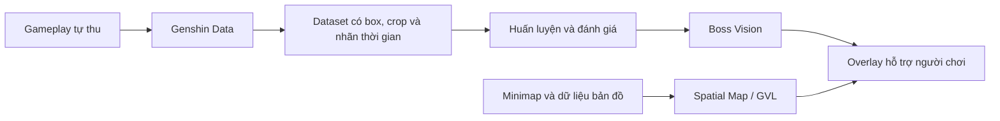
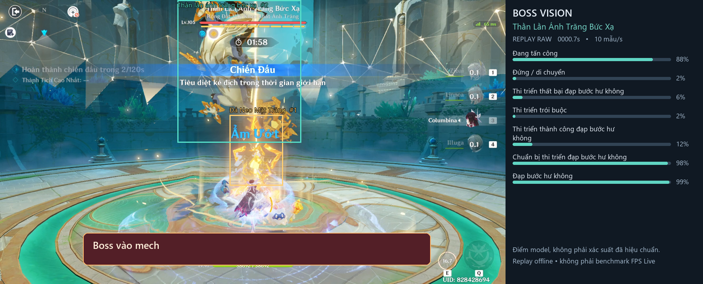

# P.A.I.M.O.N

**Trợ lý thị giác máy tính cho Genshin Impact — từ dữ liệu tự thu thập đến bản đồ và hỗ trợ khiêu chiến Boss.**

P.A.I.M.O.N kết nối ba bài toán: tạo dữ liệu gameplay có nhãn, định vị để hỗ trợ khám phá, và nhận biết hành động/cơ chế Boss từ chuỗi hình ảnh. Đầu ra hướng tới người chơi: bản đồ, hướng mục tiêu, box đối tượng, trạng thái và cảnh báo overlay.

**Kho công khai này giới thiệu sản phẩm, demo, mẫu dữ liệu và checkpoint. Mã nguồn ứng dụng được giữ riêng.** Bản EXE chưa được phát hành trong đợt giới thiệu này.

[Demo Boss](#demo-boss-vision) · [Dataset](docs/dataset-card.md) · [Map](docs/map.md) · [Checkpoint](docs/model-card.md) · [Tải tài nguyên](https://github.com/nbngoc123/P.A.I.M.O.N/releases/tag/lizard-showcase-v0.1)

## Ba phần giải quyết điều gì?

| Phân hệ | Bài toán | Người dùng nhận được |
|---|---|---|
| **[Genshin Data](docs/data-collector.md)** | Biến bản ghi gameplay thành dữ liệu có thời gian, vùng ảnh và nhãn có thể kiểm tra | Công cụ thu OBS, xử lý video, duyệt box và đoạn hành động trong cùng luồng, xuất/cập nhật dataset |
| **[Spatial Map / GVL](docs/map.md)** | Xác định vị trí từ minimap, nối vị trí với bản đồ và các điểm cần tìm | Bản đồ overlay, mục tiêu và hướng tương đối, tầng, bộ lọc ghim, chế độ thu thập đặc sản |
| **[Boss Vision](docs/boss-vision.md)** | Biết Boss/vật thể ở đâu và nhận biết trạng thái thay đổi theo thời gian | Box và tracking ID, điểm từng nhãn, crop tín hiệu và cảnh báo theo profile Boss |

Hai bài toán Map và Boss Vision có luồng xử lý riêng. Sơ đồ mô tả hệ sinh thái; không khẳng định đã có một EXE hợp nhất cả ba ứng dụng.

## Demo Boss Vision

**Boss dùng trong đợt giới thiệu: Thằn Lằn Ánh Trăng Bức Xạ.**

**[Mở / tải video suy luận](media/boss/lizard-raw-inference.mp4)** · [Nguồn và cấu hình demo](media/boss/demo-provenance.json)

Video được dựng bằng suy luận lại video raw của phiên `20261111-235058-e2e170d8`, với checkpoint đã được gán trong profile. Box, điểm state/mechanic và cảnh báo được tạo từ đầu ra mô hình cùng chính sách cảnh báo; không lấy nhãn thời gian để giả làm dự đoán.

- Box: Boss và vật thể cơ chế theo các lớp detector đã học.
- Tracking: liên kết đối tượng giữa các frame, giữ ngữ cảnh chuyển động.
- Temporal: kết hợp chuỗi ảnh, đặc trưng đối tượng và các vùng crop đã cấu hình.
- Cảnh báo: ngưỡng bật/tắt, thời gian xác nhận và cooldown theo từng nhãn.
- Overlay trong video là lớp vẽ khi replay offline; đây chưa phải video quay trực tiếp desktop overlay khi chơi.

**Giới hạn:** nguồn demo có thể trùng dữ liệu huấn luyện. Video cho thấy luồng suy luận hoạt động; không chứng minh độ chính xác trên phiên độc lập hoặc FPS Live. Điểm hiển thị là điểm model, không phải xác suất đã hiệu chuẩn. [Chi tiết Boss Vision](docs/boss-vision.md).

## Bộ dữ liệu tự xây dựng

Bộ thu và công cụ gán nhãn được xây dựng để phục vụ chính các bài toán trong P.A.I.M.O.N, thay vì chỉ lưu ảnh rời rạc.

- Video gốc theo phiên, timestamp/PTS và nguồn ảnh rõ ràng.
- Box Boss và các vật thể liên quan đến cơ chế.
- Các đoạn state/action/mechanic; nhiều nhãn có thể đồng thời tồn tại.
- Crop vùng tín hiệu, ROI và phiên bản cấu hình vùng.
- Phân biệt nhãn đã duyệt, chưa duyệt và khoảng loại khỏi đánh giá.

Repo kèm **một mẫu nhỏ** từ phiên Thằn Lằn, gồm ảnh thật, nhãn YOLO, crop và nhãn thời gian liên quan. Mẫu không đại diện toàn bộ dữ liệu và không phải benchmark độc lập.

Màu xanh là box Boss; màu vàng là vật thể nếu frame có nhãn tương ứng. Đây là ảnh minh họa ground truth đã duyệt, không phải đầu ra suy luận.

**[Xem dataset card](docs/dataset-card.md)** · [Mở mẫu dữ liệu](samples/lizard/README.md)

## Bản đồ và hỗ trợ khám phá

Map giải quyết việc nối **ảnh minimap đang thấy → vị trí trên bản đồ → điểm cần tìm**, sau đó thể hiện hướng mục tiêu và tiến độ khám phá bằng HUD.

- Định vị qua so khớp đặc trưng và theo dõi giữa các lần khớp.
- Hiển thị map, ghim, icon, tầng và các bộ lọc.
- HUD bản đồ, điều hướng theo mục tiêu và cấu hình giao diện/phím tắt.
- Chế độ thu thập đặc sản riêng: đánh dấu các điểm trong bán kính và chuyển mục tiêu tiếp theo.

Đánh dấu theo bán kính là **ước lượng đã ghé điểm**, chưa phải nhận biết người chơi nhặt thành công. Hướng XY không phải tuyến đi tối ưu tránh vật cản. Video gameplay Map sẽ được bổ sung sau; ảnh trên là ảnh giao diện đang có. [Chi tiết và các cảnh cần quay](docs/map.md).

## Checkpoint, phần mềm và trạng thái

| Tài nguyên | Phát hành |
|---|---|
| Demo Thằn Lằn | Video và ảnh trong repo |
| Mẫu dataset | Trong `samples/lizard`, ảnh và nhãn chọn lọc |
| Checkpoint detector + temporal | File ZIP ở [Releases](https://github.com/nbngoc123/P.A.I.M.O.N/releases/tag/lizard-showcase-v0.1), kèm hash và profile tương ứng |
| Ứng dụng Windows EXE | Chưa phát hành công khai |
| Mã nguồn ba ứng dụng | Giữ riêng |
| Voice assistant, tối ưu lộ trình và mở rộng nhiều Boss | Hướng phát triển; không thuộc cam kết của demo này |

Việc công khai checkpoint không có nghĩa công khai mã nguồn ứng dụng. Temporal cần đúng feature schema, thứ tự lớp, crop và cách dựng chuỗi; không thể dùng checkpoint đó như một detector YOLO độc lập. [Model card](docs/model-card.md).

## Đánh giá và giới hạn

Boss Vision được theo dõi bằng chất lượng box và chất lượng cảnh báo theo từng lần sự kiện: nhận được, bỏ sót, độ trễ, báo sai/phút và báo lặp. Map cần đánh giá độ ổn định định vị, thời gian tìm lại và độ trễ khi di chuyển. Không dùng một con số mAP để đại diện cho toàn bộ hệ thống.

Đây là dự án cá nhân thử nghiệm, không phải sản phẩm chính thức của HoYoverse. Hình ảnh và nội dung game thuộc chủ sở hữu tương ứng. Kho công khai không tự cấp quyền sử dụng lại nội dung game hoặc giấy phép cho toàn bộ phần mềm/dataset; xem [phạm vi phát hành](docs/distribution.md).
