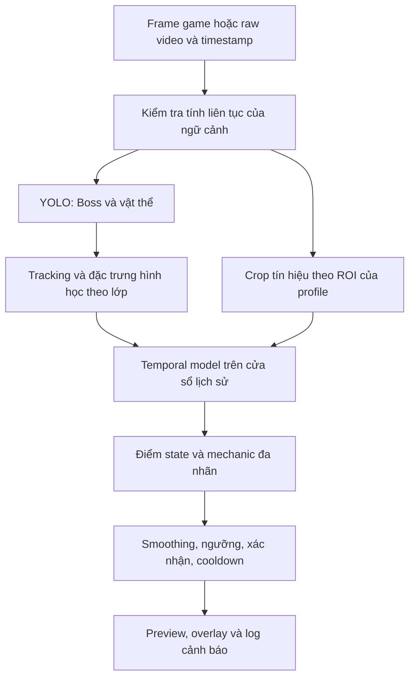

# Boss Vision — hỗ trợ khiêu chiến bằng thị giác

## Bài toán

Box cho biết Boss ở đâu; hỗ trợ chiến đấu còn cần biết Boss đang chuẩn bị gì, có dấu hiệu cơ chế nào và khi nào nên thông báo. Camera quay, người chơi/pet/tạo vật che khuất, animation Q và hiệu ứng lớn làm bài toán khó hơn nhận diện trên một ảnh tĩnh.

## Luồng hiện tại

- Các lớp box, nhãn thời gian và cảnh báo thuộc từng profile Boss; không có một bộ cơ chế cố định cho mọi Boss.
- Đặc trưng theo lớp có thể gồm vị trí, kích thước, chuyển động, số lượng, khoảng cách trung bình từ tâm Boss đến vật thể, diện tích và thay đổi diện tích. Checkpoint quyết định feature schema thực sự được dùng.
- Khoảng cách này là khoảng cách ảnh, không mặc định là mét trong thế giới game.
- Crop được xử lý trong cùng luồng suy luận; ROI có thể chọn theo profile. Đổi ROI không có nghĩa model tự học thêm tín hiệu mới.
- Model sử dụng lịch sử; khi timestamp/khung hình bị gián đoạn phải dựng lại ngữ cảnh.

## Những gì nhìn thấy trong demo

Demo công khai chỉ dùng Thằn Lằn Ánh Trăng Bức Xạ. Các điểm state/mechanic được hiển thị theo thứ tự checkpoint; cảnh báo chạy từ điểm model với đúng cấu hình đã gán. Nhãn dataset không điều khiển việc phát cảnh báo trong demo.

Video là replay offline có overlay được vẽ vào frame. Không dùng thời gian encode video để báo tốc độ Live. Phần capture trực tiếp game và overlay desktop đã có trong ứng dụng nội bộ; video quay trực tiếp sẽ là một loại minh chứng riêng.

## Huấn luyện và đánh giá

Detector được học từ box đã duyệt; temporal được học từ nhãn theo thời gian, cùng ảnh và tín hiệu đi kèm. Có thể cấu hình BCE có mask, trọng số từng lớp, mẫu âm khó, cân bằng đoạn và ưu tiên đầu dấu hiệu.

Đánh giá cảnh báo cần chạy lại qua smoothing/xác nhận/cooldown. Khi có validation phù hợp, có thể tìm cấu hình cảnh báo trong ngân sách báo sai rồi kiểm tra trên test. Chưa có deadline phản ứng đã gán thì không tuyên bố cảnh báo đủ sớm để né đòn.

Các video hoặc đoạn nhân bản có cùng nguồn không tạo thành bằng chứng độc lập. Chia ngẫu nhiên các frame gần nhau có thể làm kết quả quá lạc quan.
