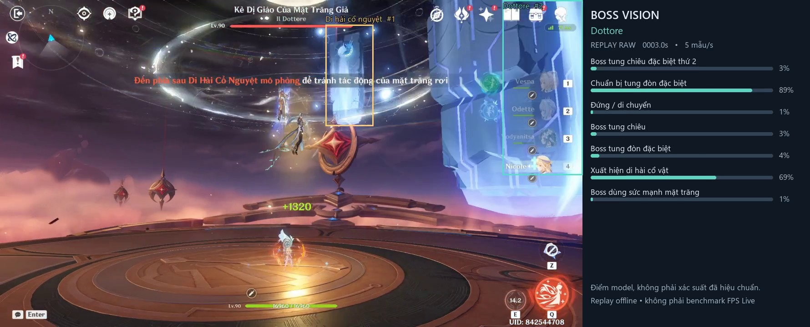
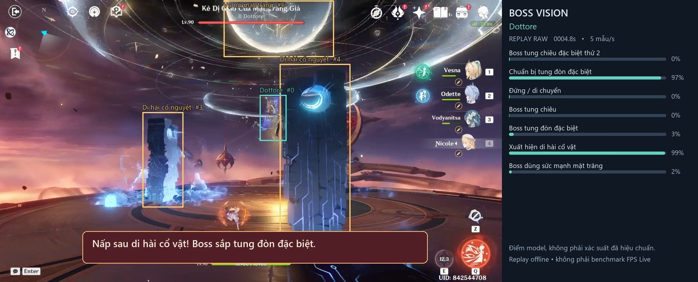
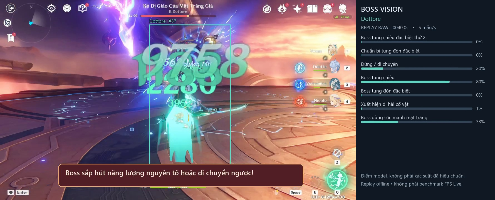
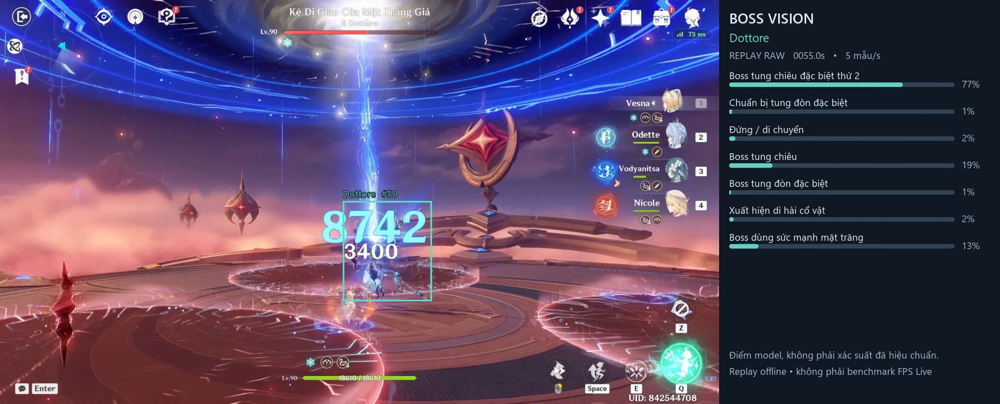
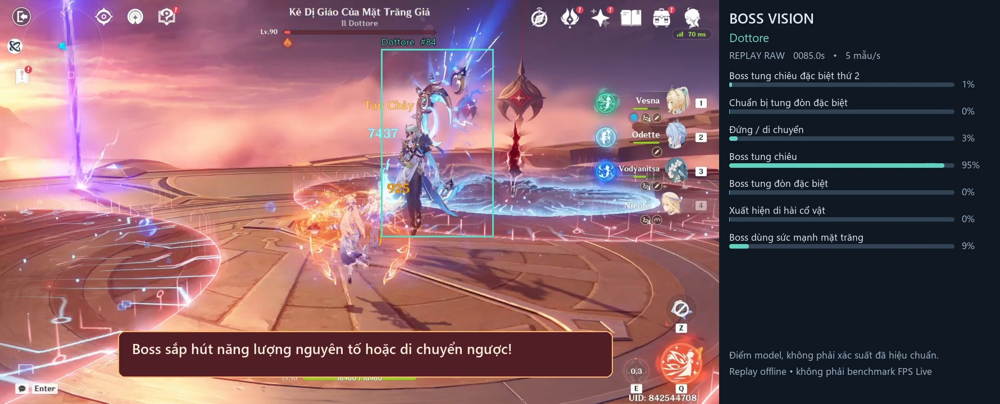
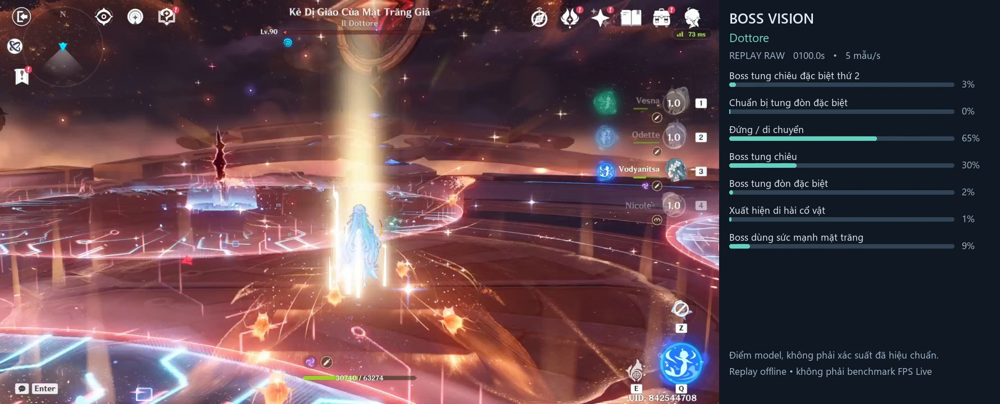
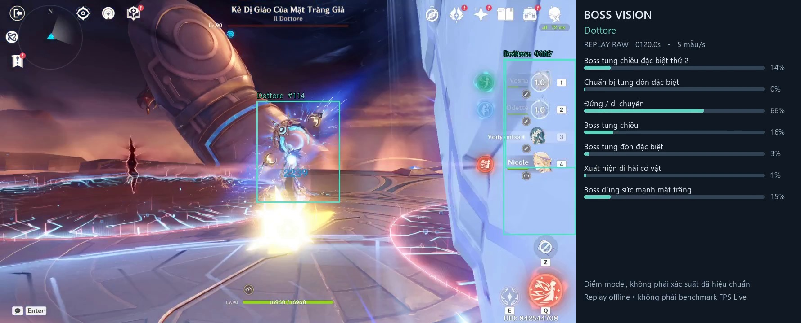

# Boss Vision — Dottore

Demo dùng raw gameplay phiên `20261108-233718-7e7c7523`, suy luận lại bằng detector và temporal đã gán trong profile Dottore. Video dài khoảng **123.6 giây**, gồm **618 mẫu suy luận**. Box, tracking ID, điểm state/mechanic và thông báo được tạo bởi luồng `LiveInference` và `TacticalAlertManager` hiện có; không lấy nhãn dataset làm dự đoán.

[Tải video MP4](https://raw.githubusercontent.com/nbngoc123/P.A.I.M.O.N/main/media/boss/dottore/dottore-raw-inference.mp4) · [Nguồn, hash checkpoint và cấu hình cảnh báo](../media/boss/dottore/demo-provenance.json)

| Thành phần | Run dùng trong demo |
|---|---|
| Detector | `dottore_1_pilot_v1-20261110-005907` |
| Temporal | `dottore_1_pilot_v1-20261110-014328` |
| Profile | Dottore, ngưỡng và thông điệp cảnh báo giữ theo bản chụp profile |

Video là replay offline, chưa phải video quay overlay desktop khi chơi Live. Nguồn có thể trùng dữ liệu huấn luyện; không dùng demo này để khẳng định độ chính xác trên phiên độc lập. Điểm model chưa hiệu chuẩn thành xác suất. Thông điệp là nội dung profile cấu hình, không phải lời khuyên chiến thuật đã xác minh.

Luồng cảnh báo phát **12 thông báo**, thuộc **3 nhãn**. Số lần phát không tự chứng minh cảnh báo đúng, đủ sớm hoặc không bỏ sót.

## 01. 3.0s

Box, tracking và điểm state/mechanic trong replay.

## 02. 4.8s

Cảnh báo do model kích hoạt: Nấp sau di hài cổ vật! Boss sắp tung đòn đặc biệt..

## 03. 7.0s

Box Dottore, Di Hài Cổ Nguyệt và vật thể mặt trăng; có cảnh báo từ model.

## 04. 14.2s

Cảnh báo do model kích hoạt: Boss sắp hút năng lượng nguyên tố hoặc di chuyển ngược!.

## 05. 40.0s

Box, tracking và điểm state/mechanic trong replay.

## 06. 55.0s

Box, tracking và điểm state/mechanic trong replay.

## 07. 70.0s

Box, tracking và điểm state/mechanic trong replay.

## 08. 85.0s

Box, tracking và điểm state/mechanic trong replay.

## 09. 92.0s

Box Dottore trong cảnh chiến đấu; điểm trạng thái Boss tung chiêu.

## 10. 100.0s

Box, tracking và điểm state/mechanic trong replay.

## 11. 110.0s

Box, tracking và điểm state/mechanic trong replay.

## 12. 120.0s

Box, tracking và điểm state/mechanic trong replay.

