# Boss Vision — Dottore

Demo dùng raw gameplay phiên `20261108-233718-7e7c7523`, suy luận lại bằng detector và temporal đã gán trong profile Dottore. Video dài khoảng **123.6 giây**, gồm **618 mẫu suy luận**. Box, tracking ID, điểm state/mechanic và thông báo được tạo bởi luồng `LiveInference` và `TacticalAlertManager` hiện có; không lấy nhãn dataset làm dự đoán.

[Tải video MP4](https://raw.githubusercontent.com/nbngoc123/P.A.I.M.O.N/main/media/boss/dottore/dottore-raw-inference.mp4) · [Nguồn, hash checkpoint và cấu hình cảnh báo](../media/boss/dottore/demo-provenance.json)

| Thành phần | Run dùng trong demo |
|---|---|
| Detector | `dottore_1_pilot_v1-20261110-005907` |
| Temporal | `dottore_1_pilot_v1-20261110-014328` |
| Profile | Dottore, ngưỡng và thông điệp cảnh báo giữ theo bản chụp profile |

Video là replay offline, chưa phải video quay overlay desktop khi chơi Live. Nguồn có thể trùng dữ liệu huấn luyện; không dùng demo này để khẳng định độ chính xác trên phiên độc lập. Điểm model chưa hiệu chuẩn thành xác suất. Thông điệp là nội dung profile cấu hình, không phải lời khuyên chiến thuật đã xác minh.

Luồng cảnh báo phát **12 thông báo**, thuộc **3 nhãn**. Số lần phát không tự chứng minh cảnh báo đúng, đủ sớm hoặc không bỏ sót.

## Các cảnh được chọn

Bộ ảnh gồm **16 cảnh** đã xem trực tiếp ở kích thước đầy đủ. Mốc thời gian lấy từ video suy luận; box và điểm số giữ theo đầu ra gốc.

| Nội dung | Mốc minh họa |
|---|---|
| Boss, Di Hài Cổ Nguyệt và vật thể mặt trăng | 3,4s; 4,8s; 7s; 8s |
| Cảnh báo và tín hiệu Sức mạnh mặt trăng | 14,2s; 30,2s; 78,8s |
| Điểm chiêu đặc biệt thứ hai | 55,2s — 91%, dưới ngưỡng bật cảnh báo 98% |
| Box Boss và thay đổi trạng thái qua nhiều góc nhìn | 85s; 90,2s; 92s; 107s; 108,6s; 110s |

## 01. 0.4s

Box Dottore ở đầu bản ghi; điểm chuẩn bị tung đòn khoảng 75%.

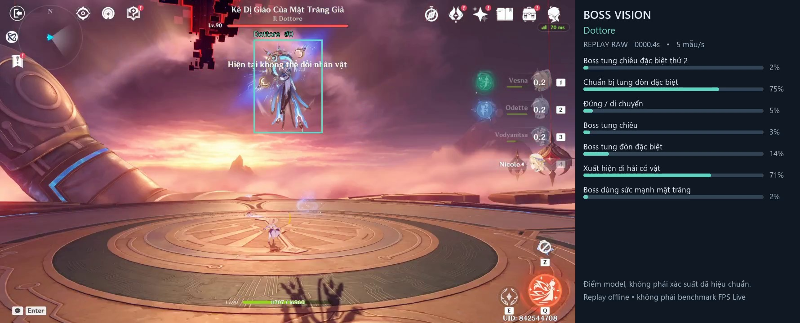

## 02. 3.4s

Boss và Di Hài Cổ Nguyệt ở góc nhìn gần.

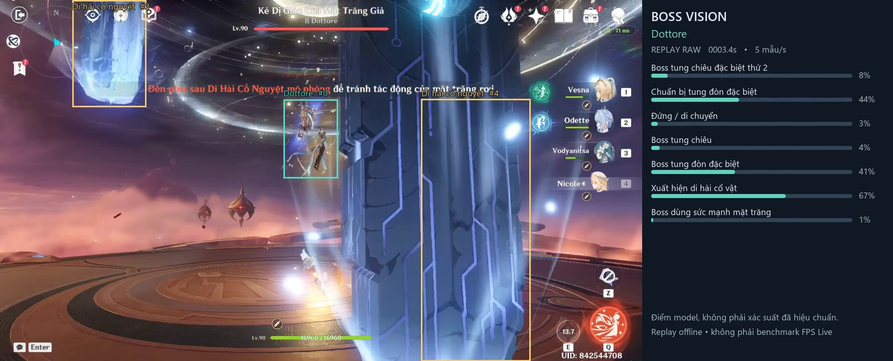

## 03. 4.8s

Cảnh báo do model kích hoạt: Nấp sau di hài cổ vật! Boss sắp tung đòn đặc biệt..

## 04. 7.0s

Box Dottore, Di Hài Cổ Nguyệt và vật thể mặt trăng; có cảnh báo từ model.

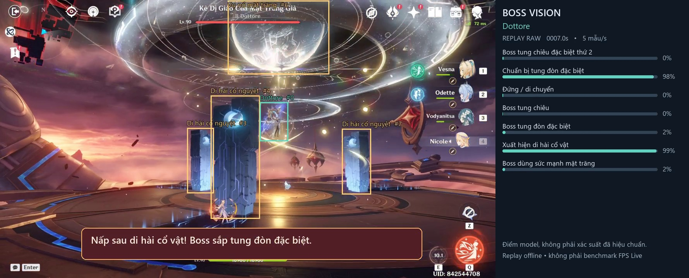

## 05. 8.0s

Boss, ba Di Hài Cổ Nguyệt và vật thể mặt trăng trong cùng khung hình.

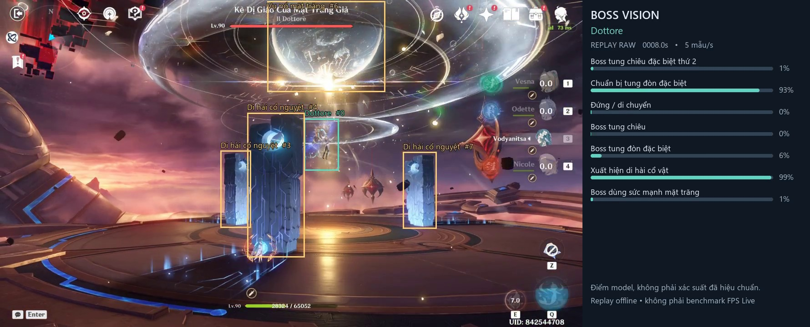

## 06. 14.2s

Cảnh báo do model kích hoạt: Boss sắp hút năng lượng nguyên tố hoặc di chuyển ngược!.

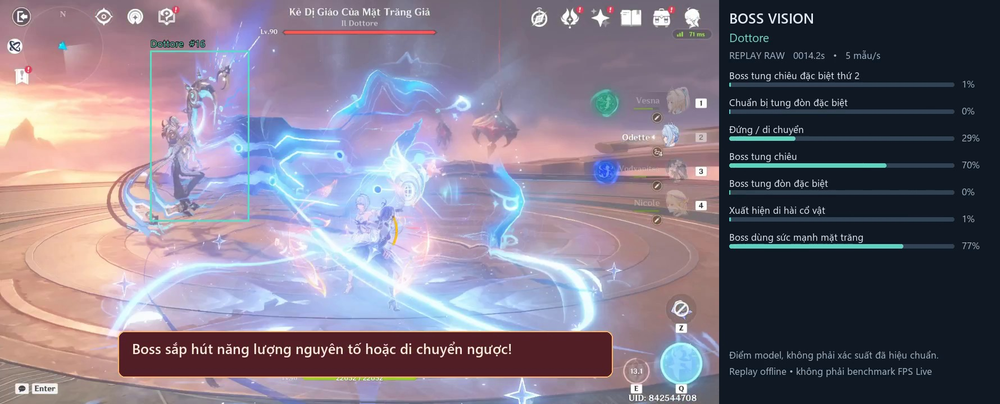

## 07. 30.2s

Box tín hiệu Sức mạnh mặt trăng; điểm mechanic khoảng 98%.

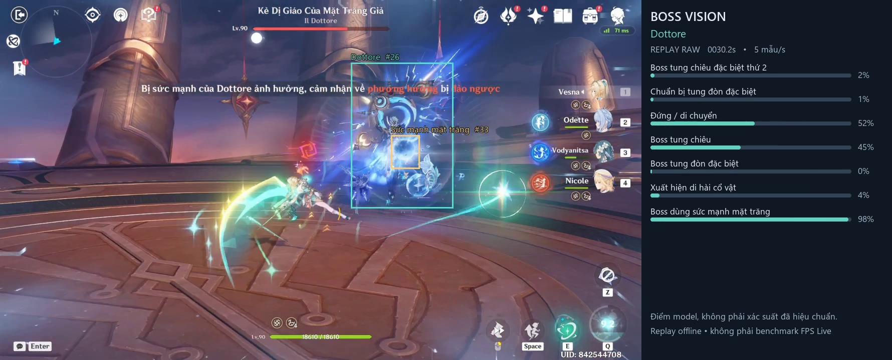

## 08. 55.2s

Chiêu đặc biệt thứ hai: điểm model 91%, chưa đạt ngưỡng cảnh báo 98%.

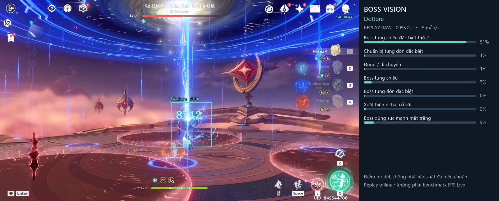

## 09. 70.0s

Box, tracking và điểm state/mechanic trong replay.

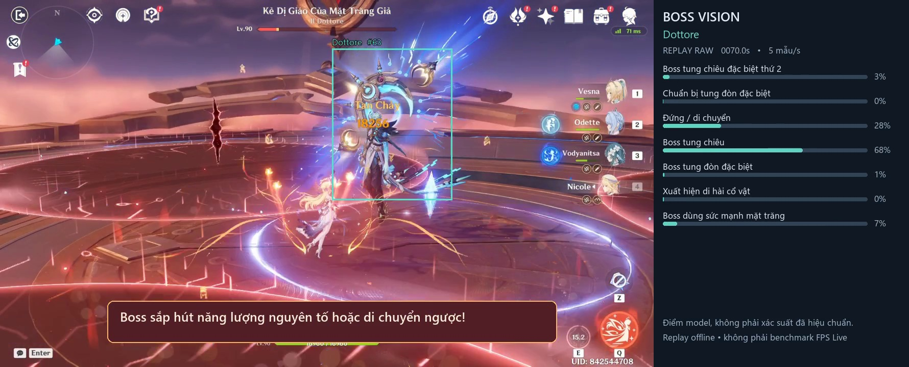

## 10. 78.8s

Cận cảnh Boss và box Sức mạnh mặt trăng.

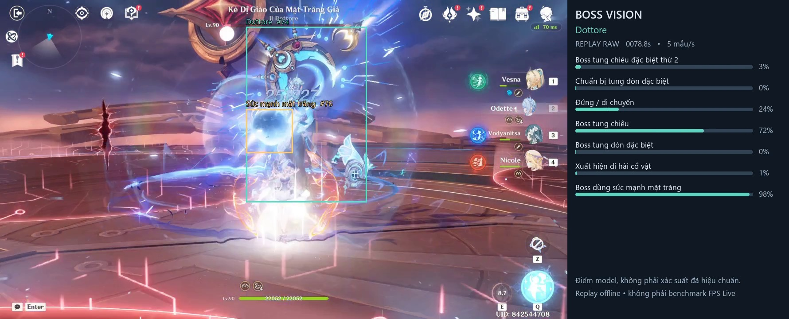

## 11. 85.0s

Box, tracking và điểm state/mechanic trong replay.

## 12. 90.2s

Boss tung chiêu: box Boss và điểm model gần 100%.

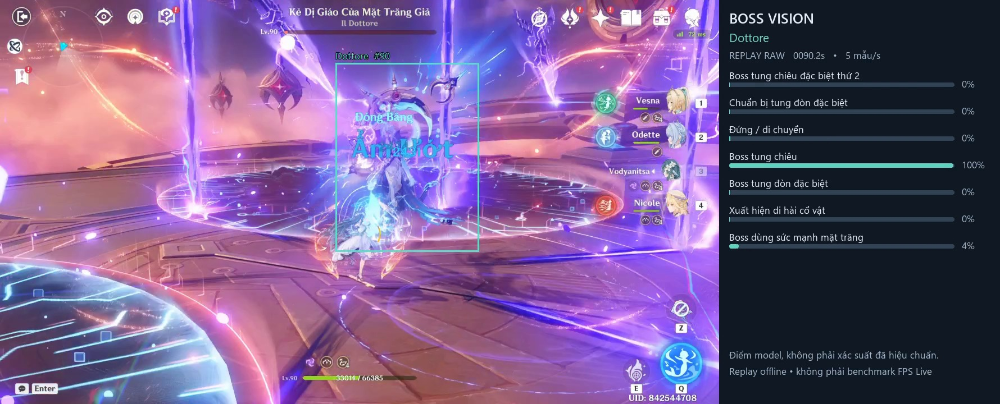

## 13. 92.0s

Box Dottore trong cảnh chiến đấu; điểm trạng thái Boss tung chiêu.

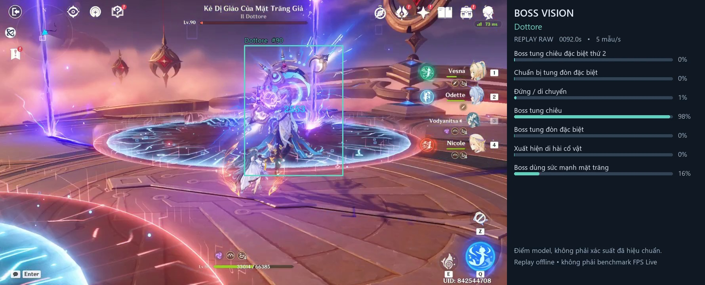

## 14. 107.0s

Box Boss trước hiệu ứng xoáy không gian.

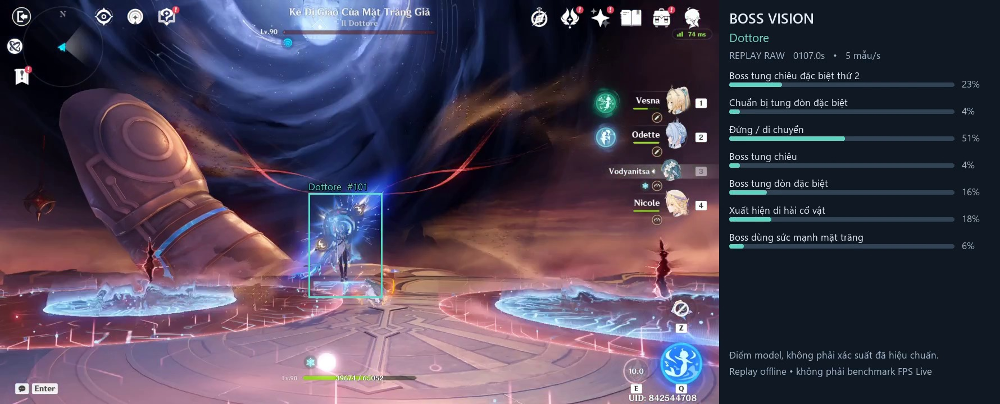

## 15. 108.6s

Tracking ID 101 được giữ qua cảnh xoáy; điểm đứng/di chuyển 83%.

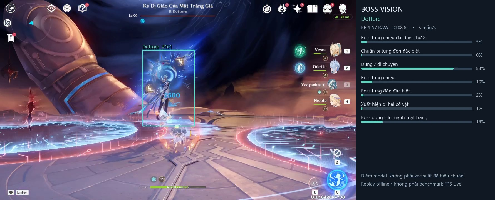

## 16. 110.0s

Box, tracking và điểm state/mechanic trong replay.

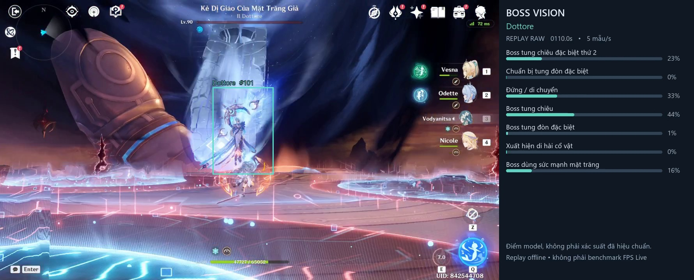

