# Map — demo từ hai video gameplay raw

Các video này chạy chính worker `Tracker` của Genshin Visual Localizer, sau đó đưa kết quả vào `SpatialState`, `OverlayController`, `MapCanvas` và HUD điều hướng sẵn có. Tọa độ được suy luận từ minimap; không gán đường đi hay tọa độ ground truth.

Đầu vào raw 1920×1080, 60 FPS. Bộ định vị lấy mẫu 4 lần/giây theo thời gian video; video kết quả 30 FPS giữ kết quả định vị gần nhất. Đây là replay offline, không phải phép đo FPS Live. Thao tác chọn ghim, bật chế độ và hoàn tác được thực hiện bằng kịch bản lúc replay; tiến độ lưu riêng cho demo.

| Demo | Phiên raw | Mẫu định vị được chấp nhận | Thời lượng bản xuất |
|---|---|---:|---:|
| Định vị và bám vị trí | `20261112-210751-21172158` | 155/157 | 39.2s |
| Điều hướng tới ghim | `20261112-211224-4678a89b` | 134/137 | 34.2s |
| Thu thập đặc sản và hoàn tác | `20261112-211224-4678a89b` | 134/137 | 34.2s |

Số mẫu được chấp nhận là trạng thái khớp hình học/theo dõi qua bộ lọc của tool, không phải độ chính xác trên tọa độ đối chứng. Khoảng cách hiển thị theo đơn vị map, chưa quy đổi sang mét.

## Định vị và bám vị trí

[Tải video MP4](https://raw.githubusercontent.com/nbngoc123/P.A.I.M.O.N/main/media/map/replay/tracking/demo.mp4) · [Nguồn và cấu hình](../media/map/replay/tracking/provenance.json)

**3.0s — Định vị và bám vị trí.**

**7.5s — Định vị và bám vị trí.**

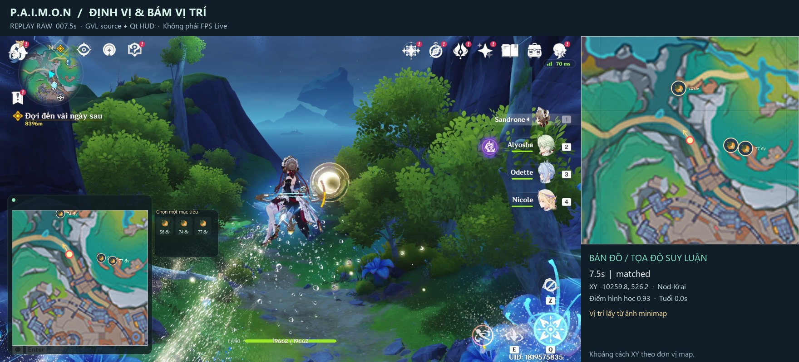

**12.0s — Định vị và bám vị trí.**

**16.5s — Định vị và bám vị trí.**

**21.0s — Định vị và bám vị trí.**

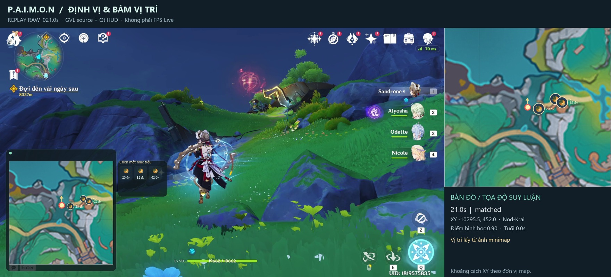

**25.5s — Định vị và bám vị trí.**

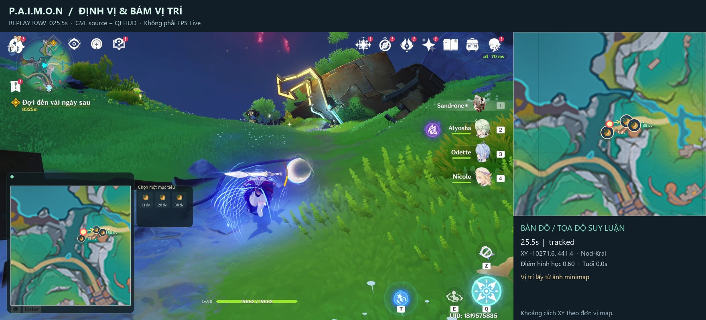

**30.0s — Định vị và bám vị trí.**

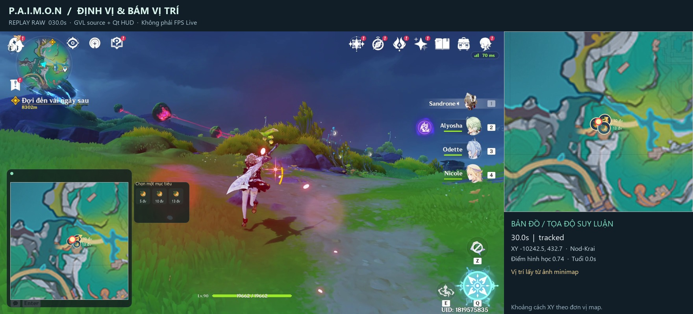

**34.5s — Định vị và bám vị trí.**

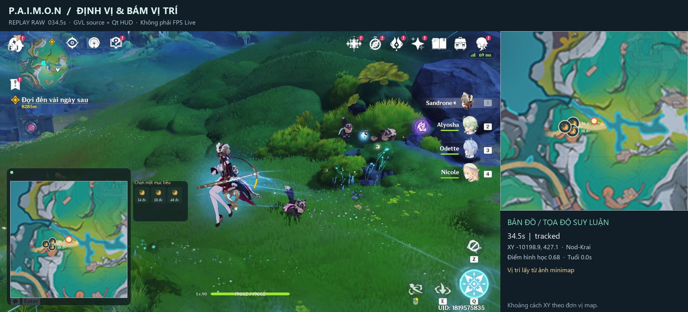

## Điều hướng tới ghim

[Tải video MP4](https://raw.githubusercontent.com/nbngoc123/P.A.I.M.O.N/main/media/map/replay/navigation/demo.mp4) · [Nguồn và cấu hình](../media/map/replay/navigation/provenance.json)

Ghim chọn từ catalog thật: **Fairy Wormwood**. Khoảng cách và mũi tên dùng vị trí/hướng suy luận trong từng thời điểm.

**3.0s — Điều hướng tới ghim.**

**7.5s — Điều hướng tới ghim.**

**12.0s — Điều hướng tới ghim.**

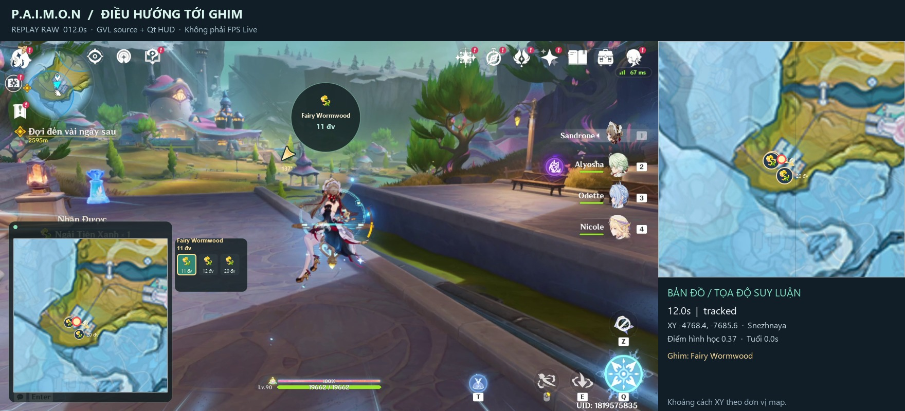

**16.5s — Điều hướng tới ghim.**

**21.0s — Điều hướng tới ghim.**

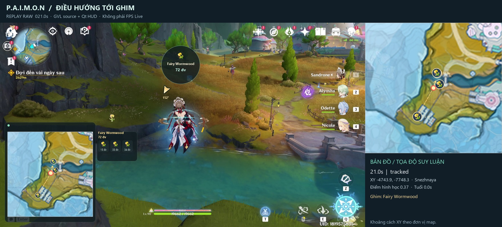

**25.5s — Điều hướng tới ghim.**

**30.0s — Điều hướng tới ghim.**

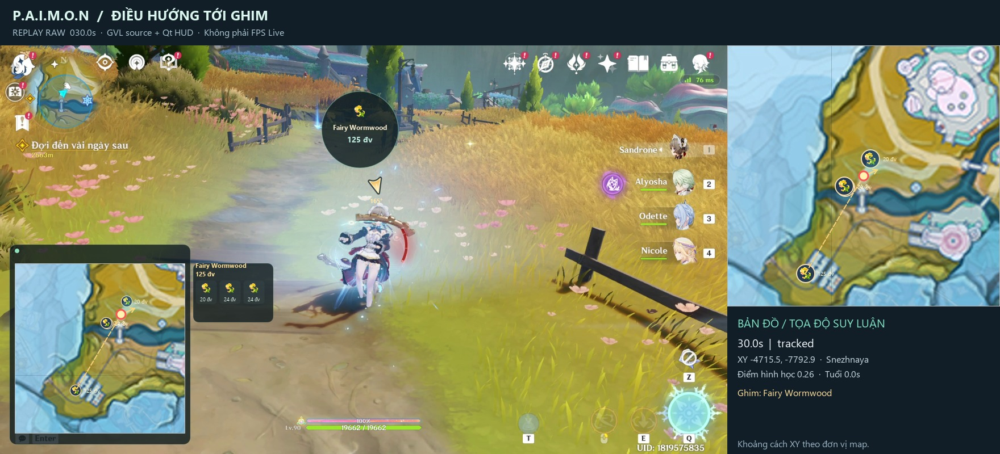

## Thu thập đặc sản và hoàn tác

[Tải video MP4](https://raw.githubusercontent.com/nbngoc123/P.A.I.M.O.N/main/media/map/replay/collection/demo.mp4) · [Nguồn và cấu hình](../media/map/replay/collection/provenance.json)

Bán kính 17 đơn vị map; đã ghi nhận 1 lượt đánh dấu với 3 ghim khác nhau, chuyển mục tiêu rồi thực hiện hoàn tác. Theo hành vi gốc của tool, hoàn tác dừng phiên thu thập. Đánh dấu theo khoảng cách chưa xác nhận đã nhặt vật phẩm.

**3.0s — Thu thập đặc sản và hoàn tác.**

**7.5s — Thu thập đặc sản và hoàn tác.**

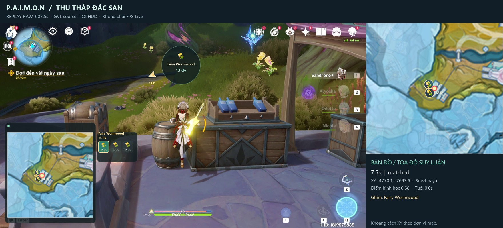

**8.5s — Đánh dấu cụm ghim và chuyển mục tiêu.**

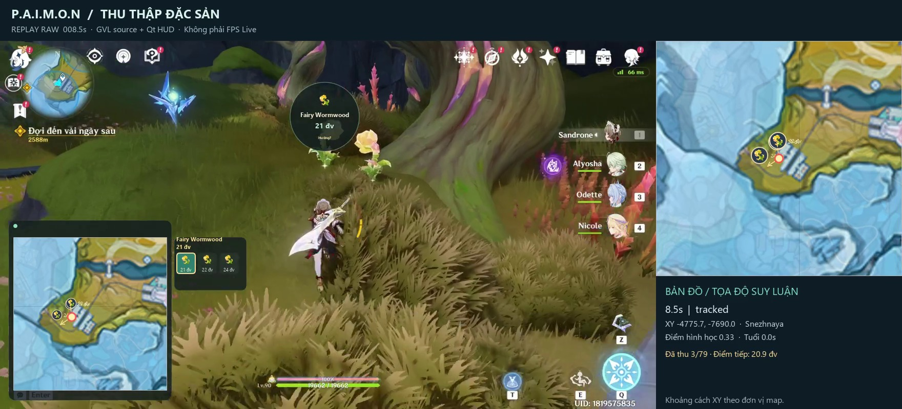

**12.0s — Thu thập đặc sản và hoàn tác.**

**12.5s — Hoàn tác lượt đánh dấu; phiên thu thập dừng.**

**16.5s — Thu thập đặc sản và hoàn tác.**

**21.0s — Thu thập đặc sản và hoàn tác.**

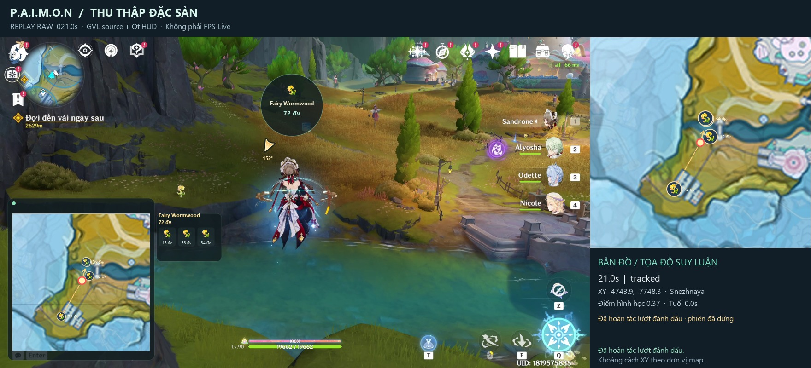

**25.5s — Thu thập đặc sản và hoàn tác.**

**30.0s — Thu thập đặc sản và hoàn tác.**

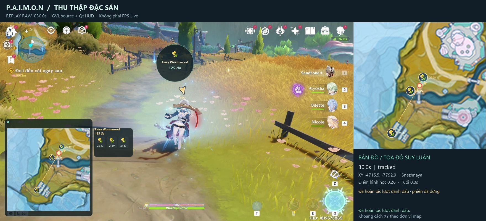

## Các chế độ hiển thị và tìm mục tiêu

Ba ví dụ bổ sung dùng cùng kết quả định vị từ hai bản ghi raw; thay bộ lọc và mục tiêu bằng chức năng Map/HUD gốc. Ghim lấy từ catalog bản đồ, chưa phải phát hiện rương/Thần Đồng trực tiếp trong ảnh game hoặc xác nhận chúng còn chưa thu thập.

### Hiện các loại vật xung quanh

[Tải video 18.0s](https://raw.githubusercontent.com/nbngoc123/P.A.I.M.O.N/main/media/map/replay/nearby/demo.mp4) · [Nguồn và bộ lọc](../media/map/replay/nearby/provenance.json)

Bật tất cả loại ghim trong catalog, lọc theo bán kính **60 đơn vị map** quanh vị trí suy luận. Bản đồ hiển thị các ghim trong vùng; dãy icon phụ liệt kê sáu điểm gần nhất. Ẩn chữ khoảng cách trên từng ghim để dễ xem nhiều loại cùng lúc.

**3.0s — Hiện các loại vật xung quanh.**

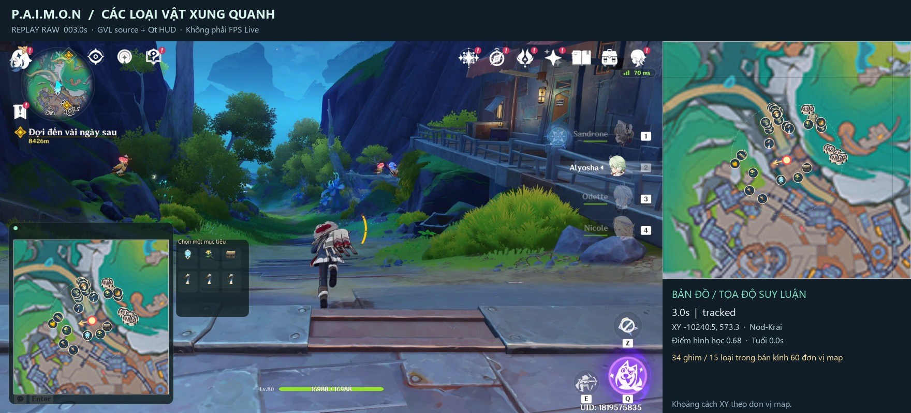

**7.5s — Hiện các loại vật xung quanh.**

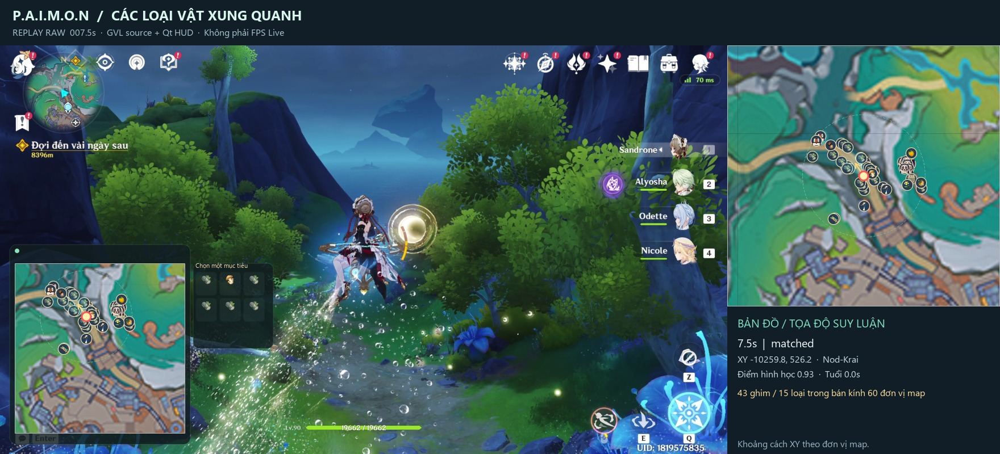

**12.0s — Hiện các loại vật xung quanh.**

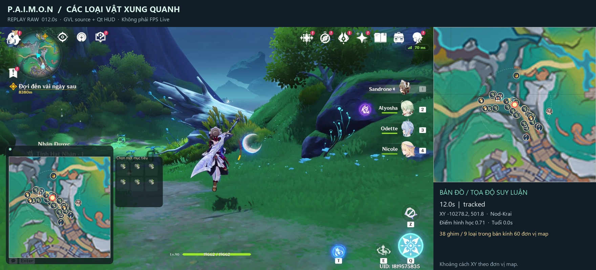

**16.5s — Hiện các loại vật xung quanh.**

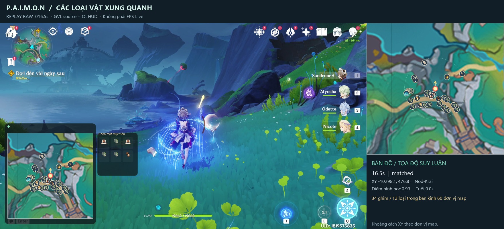

### Lọc và theo dõi rương

[Tải video 24.0s](https://raw.githubusercontent.com/nbngoc123/P.A.I.M.O.N/main/media/map/replay/chests/demo.mp4) · [Nguồn và bộ lọc](../media/map/replay/chests/provenance.json)

Lọc nhóm rương, chọn một ghim rương thật trong catalog; HUD giữ mục tiêu, hiển thị icon, khoảng cách XY và hướng tương đối khi nhân vật/camera thay đổi.

**3.0s — Lọc và theo dõi rương.**

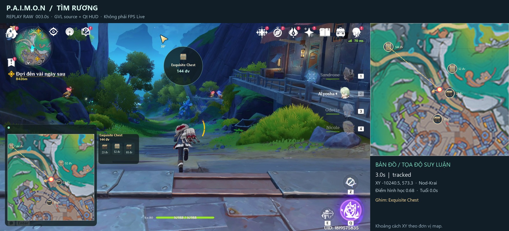

**7.5s — Lọc và theo dõi rương.**

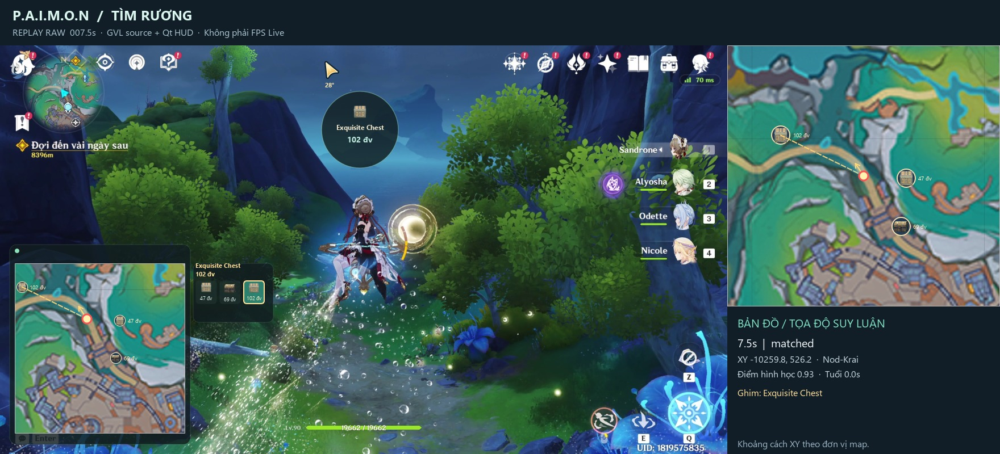

**12.0s — Lọc và theo dõi rương.**

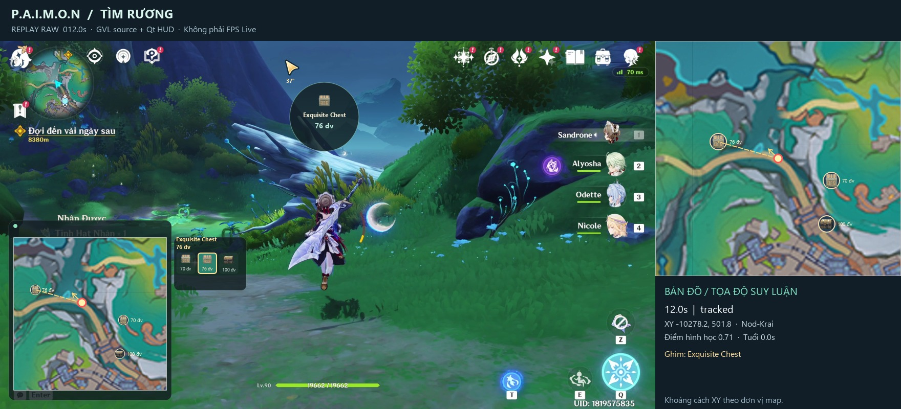

**16.5s — Lọc và theo dõi rương.**

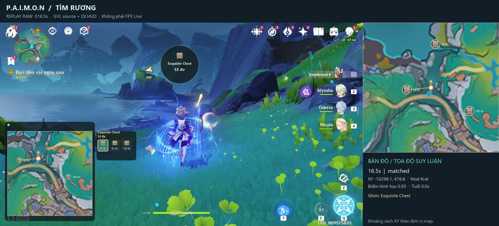

**21.0s — Lọc và theo dõi rương.**

### Lọc và theo dõi Thần Đồng

[Tải video 34.0s](https://raw.githubusercontent.com/nbngoc123/P.A.I.M.O.N/main/media/map/replay/oculus/demo.mp4) · [Nguồn và bộ lọc](../media/map/replay/oculus/provenance.json)

Lọc các loại Thần Đồng trong catalog. Ví dụ trong clip Snezhnaya theo dõi **Cryoculus**, có icon riêng, hướng và khoảng cách cập nhật theo vị trí.

**3.0s — Lọc và theo dõi Thần Đồng.**

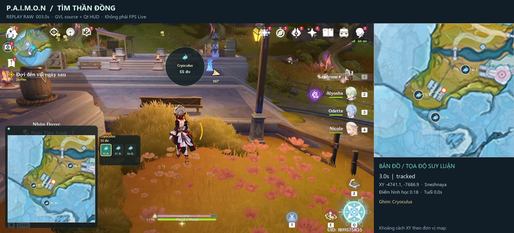

**7.5s — Lọc và theo dõi Thần Đồng.**

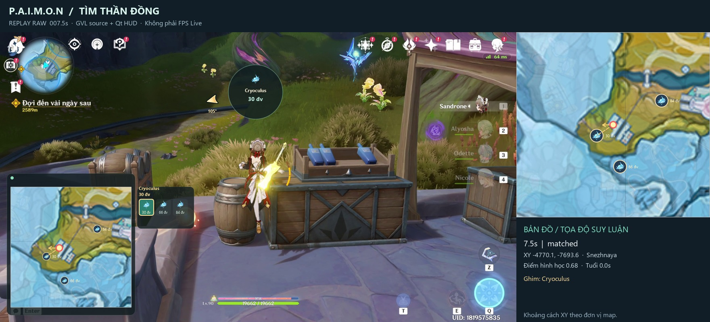

**12.0s — Lọc và theo dõi Thần Đồng.**

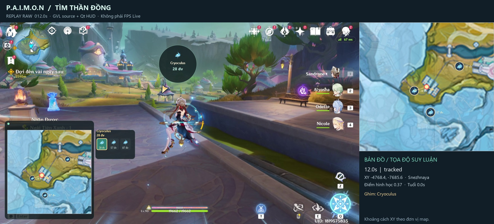

**16.5s — Lọc và theo dõi Thần Đồng.**

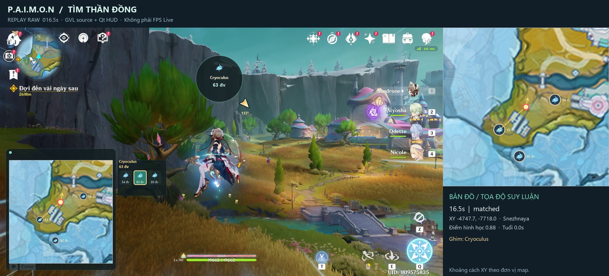

**21.0s — Lọc và theo dõi Thần Đồng.**

**25.5s — Lọc và theo dõi Thần Đồng.**

**30.0s — Lọc và theo dõi Thần Đồng.**

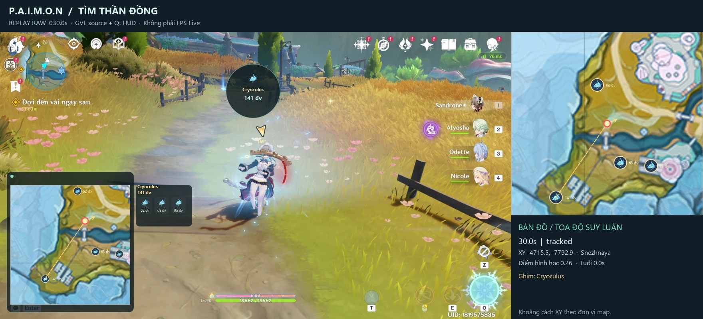

