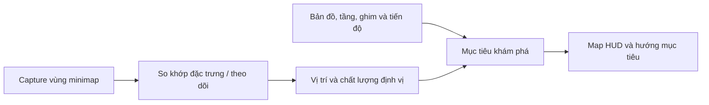
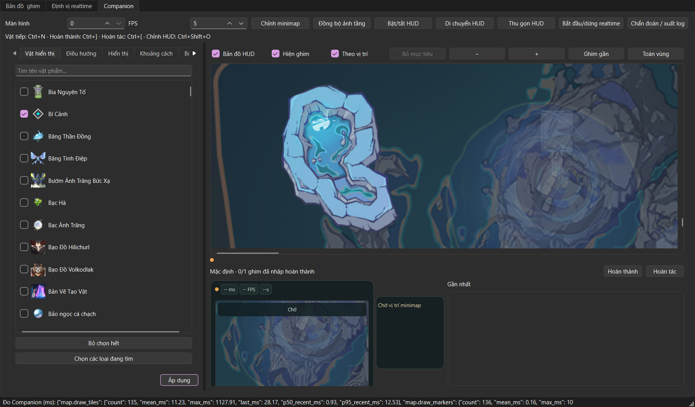
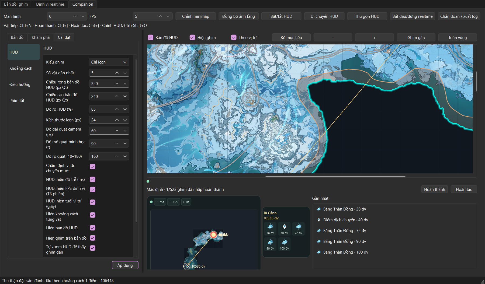
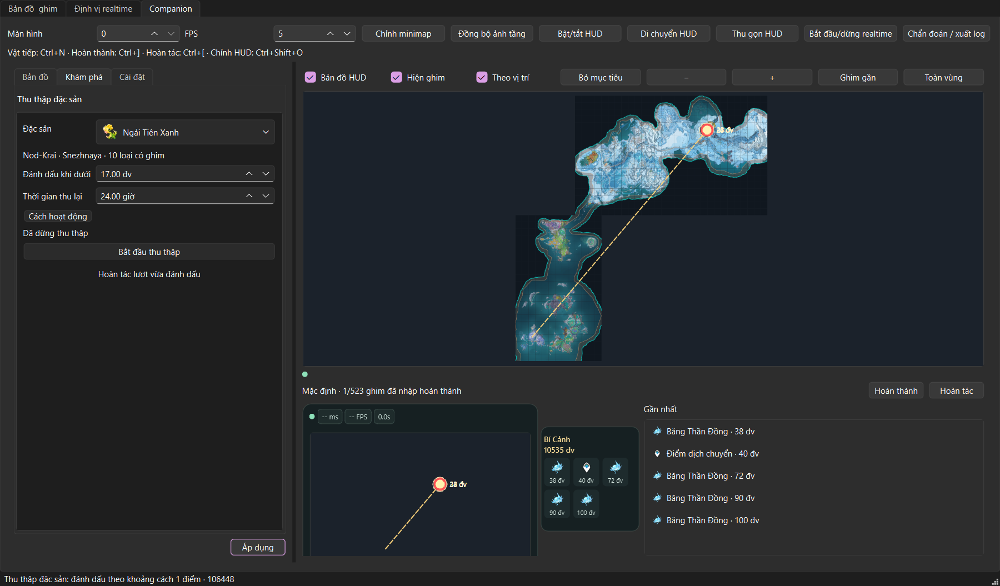
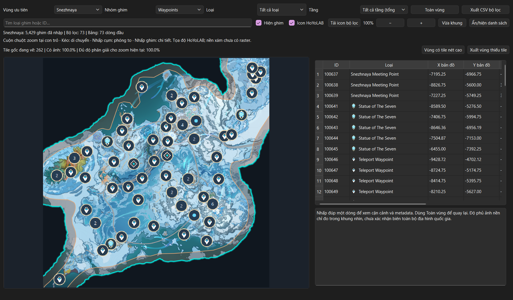
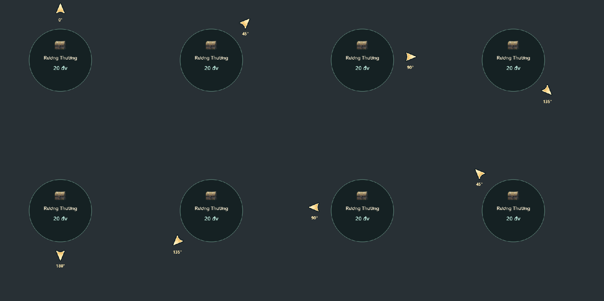

# Spatial Map / Genshin Visual Localizer

## Bài toán

Giảm việc phải liên tục chuyển cửa sổ để đối chiếu minimap với bản đồ lớn và tìm điểm thu thập. Hệ thống dùng ảnh minimap, dữ liệu bản đồ và lịch sử vị trí để hiển thị vị trí cùng các mục tiêu liên quan.

## Tính năng

- Bản đồ, icon ghim, lọc mục cần tìm và dữ liệu tầng.
- Định vị từ ảnh, theo dõi chuyển động và tìm lại khi mất dấu.
- HUD bản đồ và hướng mục tiêu, chỉnh vị trí/kích thước, phím tắt.
- Thông tin độ trễ/FPS và tuổi kết quả định vị để kiểm tra hoạt động.
- Chế độ đặc sản: chọn loại, đánh dấu các điểm cùng tầng trong bán kính, chuyển tới điểm chưa đánh dấu gần nhất, có hoàn tác và thời gian chờ cấu hình được.

Đánh dấu theo bán kính chưa xác nhận người chơi thực sự nhặt được vật phẩm. Khoảng cách XY không thay thế đường đi trên địa hình. Đơn vị mét cần hiệu chuẩn. Hiện chưa giới thiệu bộ tối ưu lộ trình nhiều điểm có vật cản/độ cao.

## 1. Định vị minimap và giữ vị trí

Đầu vào là vùng ảnh minimap được chọn trên màn hình. Bộ định vị dùng đặc trưng thị giác và xác minh hình học để tìm điểm tương ứng trong ảnh bản đồ tham chiếu; không đọc tọa độ từ bộ nhớ game và không dùng OCR cho luồng định vị này.

Khi đã biết vị trí, hệ thống ưu tiên theo dõi chuyển động và tìm cục bộ quanh kết quả gần nhất. Nếu không đủ bằng chứng, nó thử các tầng gần trong hệ tọa độ chung rồi tìm rộng hơn. Việc ưu tiên vùng gần giảm khối lượng tìm kiếm trong chuyển động bình thường; không khóa vĩnh viễn kết quả trong một bán kính khi dịch chuyển xa hoặc mất dấu.

Frame capture và kết quả xử lý đi qua hàng đợi giữ dữ liệu mới để tránh dồn độ trễ. Chất lượng hình học, xác nhận theo thời gian và tuổi kết quả giúp phân biệt vị trí mới với điểm cuối cùng đã biết.

Chấm nhân vật giữ vị trí cuối đã xác nhận khi đang tìm lại, không tự biến mất chỉ vì frame mới chưa xử lý xong. Chấm đó không phải dự đoán rằng người chơi vẫn đang đứng yên: tuổi vị trí và trạng thái cập nhật phải được đọc cùng nó. Chuyển hệ tham chiếu hoặc tài khoản có thể xóa vị trí cũ.

## 2. Bản đồ, ghim và tiến độ

Map trình bày tile nền và icon loại ghim; có zoom, kéo, gom cụm, chọn mục tiêu, lọc loại/tầng/tiến độ và danh sách điểm gần. Người chơi có thể giới hạn ghim hiển thị quanh nhân vật để giảm rối.

Tiến độ đánh dấu và thao tác hoàn tác lưu cục bộ. Hồ sơ theo UID/biệt danh giúp tách tiến độ của nhiều tài khoản, không yêu cầu đăng nhập game trong tool và không tự đồng bộ tiến độ HoYoLAB. Bản đồ/cache/index dùng chung, còn tiến độ cá nhân được tách.

Dữ liệu bản đồ là snapshot đã nhập vào tool. Có ảnh nền không đồng nghĩa đã phủ mọi khu vực, mọi tầng hoặc phiên bản mới nhất; vùng chưa có ảnh tham chiếu thì thuật toán không thể tự tạo dữ liệu địa hình còn thiếu. Kho giới thiệu không phát hành toàn bộ cache ảnh/pin từ nguồn bên thứ ba.

## 3. Tầng ngầm và lối vào

Ảnh tầng được đặt chung trong hệ tọa độ bản đồ, không tách thành một thế giới tọa độ độc lập. Tầng đang xem rõ hơn, mặt đất và tầng khác giảm độ trong suốt để vẫn thấy quan hệ không gian.

Hiệu ứng này chỉ dùng khi vẽ UI. Bộ định vị so khớp ảnh tham chiếu gốc và mask alpha, không dùng ảnh giao diện đã giảm opacity để tính vị trí. Tuy vậy, vẽ nhiều tầng vẫn có chi phí hiển thị và bộ nhớ.

Cửa hang và lối nối dùng loại/icon trong catalog. Hiển thị pin tuân theo bộ lọc người dùng; quan hệ cửa vào–tầng vẫn là metadata kể cả khi icon bị ẩn. Có thể giới hạn tầng thủ công hoặc dùng chế độ tự động; chọn sai tầng thủ công có thể giới hạn nhầm phạm vi tìm.

Hiện quan hệ lối vào chưa đồng nghĩa đã có đồ thị đường đi để tự dẫn qua cửa hang, thang máy và nhiều tầng.

Ảnh trên minh họa cách ghép tầng trong UI; trạng thái đang chờ minimap không phải bằng chứng đã định vị thành công trong hang.

## 4. HUD bản đồ và điều hướng mục tiêu

HUD giúp xem vị trí, các điểm gần và mục tiêu ngay khi chơi. Ô điều hướng thể hiện icon/tên mục tiêu, khoảng cách và mũi tên tương đối; có thể chỉnh vị trí, tỷ lệ, độ rõ và phím tắt. Có chế độ chỉnh/kéo HUD và khóa để thao tác xuyên qua giao diện khi chơi.

Khi hướng camera hoặc vị trí không đủ mới, không nên coi hướng mục tiêu là thông tin vừa đo. Chế độ báo ở xung quanh dựa trên ngưỡng khoảng cách cấu hình được; đơn vị mặc định là đơn vị bản đồ. Chỉ gọi là mét khi đã hiệu chuẩn hệ số quy đổi.

Điều hướng hiện là hướng XY đến mục tiêu. Nó chưa tính đường leo, đường vòng, độ cao, vách núi, tốc độ bơi hoặc đường ngắn nhất có thể đi được trong thế giới 3D.

## 5. Nghiệp vụ thu thập đặc sản

Chế độ này có mục tiêu và tiến độ riêng với tracking thường:

1. Chọn loại đặc sản và bán kính đánh dấu, đặt thời gian chờ thu lại.
2. Tool chọn một điểm còn lại gần vị trí hiện tại, cùng loại và phù hợp tầng.
3. Khi nhận một vị trí mới đủ điều kiện, đánh dấu đồng thời các điểm trong bán kính, không chỉ riêng mục tiêu đang chọn.
4. Cập nhật map/danh sách và chuyển sang điểm còn lại gần nhất.
5. Có thể dừng hoặc hoàn tác lượt đánh dấu; thời gian chờ tính riêng từ từng lần đánh dấu.

Điểm cũ/định vị quá hạn không được dùng để xác nhận một lượt đánh dấu mới. Thời gian chờ là tham số, không phải cơ chế tự đọc reset trong game. Đánh dấu theo khoảng cách có thể sai khi đứng khác độ cao, không tới được vật hoặc đi ngang chưa nhặt; nhận diện thông báo nhận vật phẩm là hướng cải tiến riêng.

Ảnh UI kiểm chứng từ một mốc phát triển; các số và trạng thái minh họa không dùng làm kết quả một phiên farm thật hoặc cam kết giao diện hiện tại giống từng pixel.

## 6. Đo hiệu năng và minh chứng

| Điều cần đánh giá | Bằng chứng cần có |
|---|---|
| Tìm vị trí lần đầu | Thời gian từ bắt đầu đến vị trí đầu được xác nhận |
| Bám khi di chuyển | Video liên tục và chuỗi kết quả theo timestamp |
| Phục hồi mất dấu | Thời gian mất dấu/tìm lại, có hay không khớp nhầm vùng |
| Chuyển tầng | Cảnh vào/ra hang, tầng công bố và điểm trên map |
| Phản hồi HUD | FPS xử lý, độ trễ và tuổi vị trí, không chỉ FPS capture |
| Thu thập | Lượt đánh dấu, số điểm, đổi mục tiêu và hoàn tác |

Hiện có ảnh giao diện và kiểm chứng tổng hợp. Các ảnh đó không thay thế video gameplay đối chứng. Chưa công bố một giá trị sai số vị trí/FPS đúng cho mọi máy hoặc mọi vùng.

## Ảnh hiện có

Ảnh giao diện catalog từ quá trình phát triển; không phải video định vị Live.

Ảnh kiểm tra bố cục tổng hợp, dùng để kiểm tra mũi tên/chữ có chồng nhau; không chứng minh hướng định vị thật.

## Các cảnh cần quay để bổ sung demo thật

1. **Định vị và bám vị trí, 30–45 giây:** mở game, bật HUD, di chuyển rồi quay camera; để thấy minimap game và HUD cùng lúc.
2. **Đi tới một ghim, 30–45 giây:** chọn ghim, cho thấy icon/khoảng cách/hướng đổi khi tiến gần và quay trái/phải.
3. **Thu thập đặc sản, 30–60 giây:** chọn loại, bật chế độ thu thập, đi vào bán kính một cụm, cho thấy cụm bị đánh dấu và mục tiêu chuyển; thử hoàn tác một lần.
4. **Tầng và tìm lại, tùy điều kiện:** đi qua cửa hang/chuyển tầng hoặc dịch chuyển xa; để thấy trạng thái chờ/tìm lại và phục hồi vị trí.

Quay toàn bộ game với overlay, giữ độ phân giải và UI scale ổn định. Mỗi clip ghi ngày, phiên bản tool và khu vực. Nếu không muốn công khai UID/tên tài khoản, che trước khi quay. Các clip này chưa có trong bản giới thiệu ban đầu.
